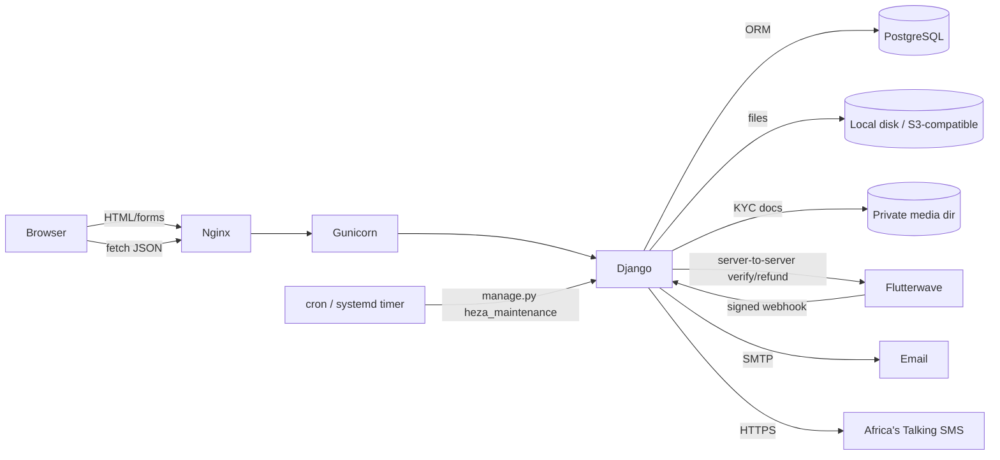
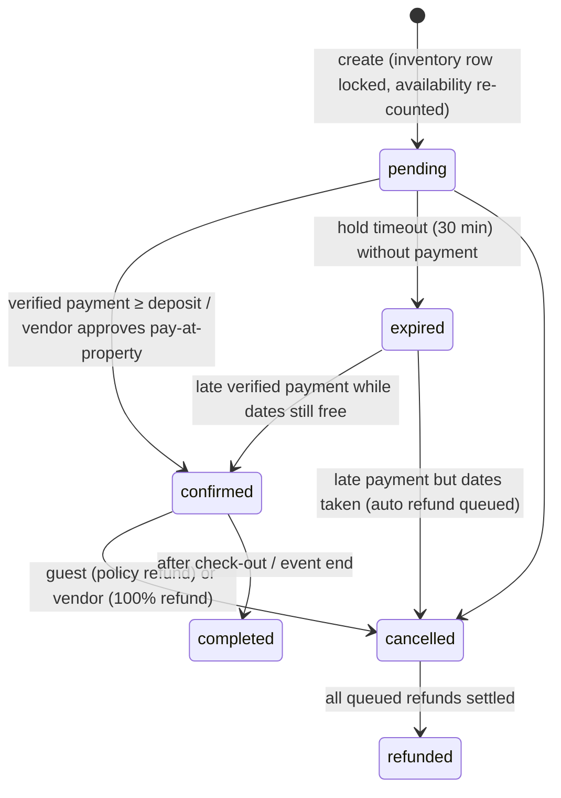
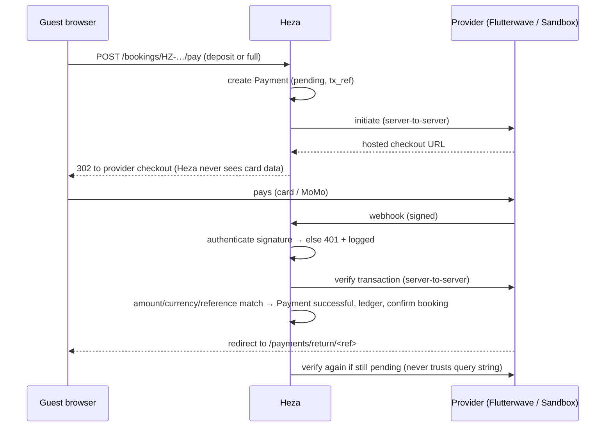

# Heza — System architecture

Heza is a server-rendered Django 5 monolith with a small DRF JSON API for the interactive
parts (search, availability calendars, live price quotes, venue slots). PostgreSQL is the
system of record. There is no SPA: pages are Django templates styled with Bootstrap 5 and
progressively enhanced with vanilla JS.



## Folder structure

```
heza/                 Django project (settings, urls, wsgi/asgi)
apps/
  core/               PlatformSettings, CategoryCommission, AuditLog, RBAC, rate limiting,
                      upload validators, security headers, template filters
  accounts/           Custom User (email + phone, role enum, suspension), auth views,
                      email verification, password reset, profile, notifications inbox
  vendors/            Vendor, VendorDocument (private storage), StaffMembership, StaffInvite,
                      partner register/login, onboarding wizard, invite acceptance
  properties/         Property, Amenity, galleries, RoomType, SeasonalRate, RoomBlock,
                      Venue, VenuePackage, VenueExtra, VenueBlock, Favorite, Inquiry
  bookings/           Booking, BookingExtra, BookingEvent, Coupon
                      pricing.py (quotes) · availability.py · services.py (state machine)
  payments/           Payment, WebhookEvent, Wallet, LedgerEntry, Refund, Payout, SandboxTransaction
                      providers/ (base, sandbox, flutterwave) · services.py (ledger, refunds, payouts)
  reviews/            Review (verified bookings only) + moderation
  notifications/      Notification log, email/SMS/WhatsApp backends, event fan-out
  reports/            Report queries + CSV export (shared by vendor and admin dashboards)
  dashboard/          Vendor portal (owner / property manager / receptionist)
  adminpanel/         Super-admin console
  api/                DRF endpoints
  public/             Customer-facing site (home, search, detail, compare, favorites, static pages)
templates/            All templates, grouped by area (public/, accounts/, dashboard/, adminpanel/ …)
static/               css/heza.css, js/*.js, vendor/ (Bootstrap, Bootstrap Icons, Leaflet — self-hosted)
seed_assets/          Demo photography used by `manage.py seed_demo`
docs/                 This documentation
deploy/               Nginx, systemd and backup samples
```

## Roles and access control

| Role | Where | Can |
|---|---|---|
| `super_admin` | `/admin-panel/` | Everything: approve vendors and properties, users, money, moderation, settings, audit |
| `vendor_owner` | `/dashboard/` | Everything for their own vendor: listings, pricing, bookings, finance, staff, settings |
| `property_manager` | `/dashboard/` | Listings, pricing, availability, bookings, reports, reviews for assigned properties |
| `receptionist` | `/dashboard/` | Bookings (check-in, record payments at desk, cancel), availability view, inquiries |
| `customer` | public site | Search, book, pay, cancel/modify, review, favorites |

`apps/core/rbac.py` builds a `VendorContext` for every dashboard request. Staff memberships
can be restricted to a subset of properties; every queryset in the vendor portal is filtered
through `ctx.properties()` / `ctx.bookings()`, so cross-vendor access returns 404. Permission
strings (`listings`, `finance`, `staff` …) are checked by the `@vendor_required(perm)` decorator.
Platform admin views use `@admin_required`. Django's own `/django-admin/` is kept for
emergency data fixes and is restricted to superusers.

## Authentication flow

1. Customers register at `/accounts/register/`; partners at `/partner/register/` (creates a
   `vendor_owner` user plus a draft Vendor). Staff join only by invitation (`/partner/invite/<token>/`).
2. Login accepts email or phone (`EmailOrPhoneBackend`). Suspended users are refused at login
   and logged out mid-session by `SuspendedUserMiddleware`.
3. A signed, expiring (3 days) email verification link is sent on registration. Unverified users
   can browse but cannot book or submit a vendor application.
4. Password reset uses Django's token generator. Login, register, reset and contact forms are
   rate-limited per IP (`apps/core/ratelimit.py`).
5. Sessions are cookie-based, HttpOnly, SameSite=Lax, Secure under HTTPS.

## Booking flow



* **No double booking.** `create_room_booking` / `create_venue_booking` run in a transaction
  that takes `SELECT … FOR UPDATE` on the `RoomType` or `Venue` row, then counts overlapping
  bookings that still hold inventory (confirmed, completed, or pending with a live hold) plus
  vendor blocks. Concurrent requests for the last unit serialise on that lock.
* **Rooms** are inventory pools (`RoomType.quantity`). Availability per night =
  quantity − booked − blocked. **Venues** are single resources booked by time window with a
  turnover buffer between events.
* **Pricing** (`bookings/pricing.py`): seasonal rate › weekend rate › base nightly rate per
  night; venues price by mode (hourly, half day, full day, whole event) plus packages (per guest
  or per event) and extras (per event / guest / hour / item). Coupons, then VAT (18% default,
  inclusive or exclusive), then the deposit (vendor sets full payment or a deposit %).
* **Commission** resolution: vendor override › category override › platform default (10%).
  The rate is snapshotted onto the booking.
* **Modification** re-checks availability excluding the booking itself and re-prices. A lower
  total queues a refund for the difference; a higher total leaves a balance to pay.
* **Cancellation** refund = policy % (flexible / moderate / strict / non-refundable) of what was
  paid online; vendor cancellations refund 100%.
* `manage.py heza_maintenance` (cron every 5 minutes) expires stale holds and completes past
  bookings.

## Payment flow



* **Provider interface** (`payments/providers/base.py`): `initiate`, `verify`, `parse_webhook`,
  `refund`. Adapters: `FlutterwaveProvider` (v3 Standard checkout, `verif-hash` webhook header,
  `/transactions/{id}/verify`, refunds) and `SandboxProvider` (local gateway with its own
  transaction table and HMAC-SHA256 signed, timestamped webhooks).
* **Idempotency:** webhook events are stored with the provider event id and processed once;
  `apply_verification` locks the payment row and is a no-op once successful.
* **Ledger:** every successful online payment credits the vendor wallet with the net amount
  and the platform wallet with commission. Cash/POS collected at the property debits the vendor
  wallet by the commission. Refunds reverse both sides proportionally. Payouts debit the vendor
  wallet when marked paid; requested/approved payouts are reserved from the available balance.
* **Refunds** are queued (cancellations, overpayments, late payments) and processed by a
  super admin through the provider's refund API.
* Credentials come from environment variables only. Card numbers/CVV never touch Heza
  (hosted checkout); stored gateway responses are whitelisted to non-sensitive fields.

## Notifications

`notifications/services.py` fans each booking event out to email (Django mail; console in dev),
in-app inbox, SMS (`ConsoleSMSBackend` or `AfricasTalkingSMSBackend`) and WhatsApp (console stub).
Every send is logged in `Notification` with status; failures never break the booking flow.

## Security summary

CSRF on all forms (webhooks are the only `csrf_exempt` endpoints and are signature-checked);
auto-escaped templates and a strict Content-Security-Policy (no inline scripts); ORM only, no raw
SQL; uploads validated by extension, size and content (Pillow / magic bytes) and stored under
random names, with KYC documents outside the public media root and served through a permission
check; per-IP rate limits; RBAC on every view; append-only `AuditLog` for admin and money actions;
HTTPS/HSTS/secure cookies enabled with `SECURE_SSL=1`. See `docs/deployment.md`.
