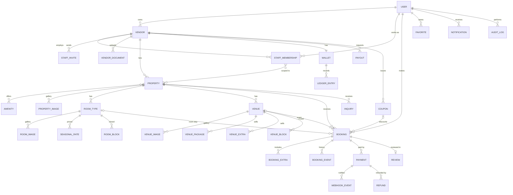

# Heza — Database schema

PostgreSQL 14+ (developed on 16). All money columns are `NUMERIC(14,2)` with an ISO currency
code alongside (RWF by default). Timestamps are timezone-aware (UTC in the database, displayed in
Africa/Kigali).

## Entity-relationship diagram

## Tables

### Accounts & platform
| Table | Key columns | Notes |
|---|---|---|
| `accounts_user` | email (unique), phone, role, is_email_verified, is_suspended, suspended_reason | Custom user, no username |
| `core_platformsettings` | commission_rate, tax_rate, tax_inclusive, min_payout_amount | Singleton (pk=1), cached |
| `core_categorycommission` | category (unique), rate | Overrides platform commission per property category |
| `core_auditlog` | actor, action, target_type, target_id, ip_address, metadata (JSON), created_at | Append-only |

### Vendors
| Table | Key columns | Notes |
|---|---|---|
| `vendors_vendor` | owner→user, business_name, slug, tin, status (draft/pending/approved/rejected/suspended), commission_rate (nullable override), payout_* | One owner may own several vendors; UI uses the first |
| `vendors_vendordocument` | vendor, doc_type, file (private storage), status | KYC files served only through permission-checked view |
| `vendors_staffmembership` | vendor, user, role (property_manager/receptionist), properties M2M, is_active | unique(vendor, user) |
| `vendors_staffinvite` | vendor, email, role, properties M2M, token (unique), expires_at, accepted_at, revoked | 7-day expiry |

### Listings
| Table | Key columns | Notes |
|---|---|---|
| `properties_property` | vendor, slug, category, city, lat/lng, status (draft/pending/verified/rejected/suspended), cancellation_policy, payment_mode, deposit_percent, allow_pay_later, starting_price, rating_avg, review_count | Public only when `status=verified` **and** vendor approved |
| `properties_amenity` | name, slug, icon, scope | Shared catalogue |
| `properties_propertyimage` / `roomimage` / `venueimage` | image, caption, sort_order | Random file names |
| `properties_roomtype` | property, category, max_adults, max_children, bed_type, bed_count, base_price, weekend_price, quantity | Inventory pool |
| `properties_seasonalrate` | room_type, start_date, end_date (inclusive), nightly_price, min_nights | CHECK end ≥ start |
| `properties_roomblock` | room_type, start_date, end_date (exclusive), units | CHECK end > start |
| `properties_venue` | property, setting, capacity_seated/standing, hourly/half_day/full_day/event prices, opening/closing time, turnover_minutes | Single bookable resource |
| `properties_venuepackage` | venue, price, unit (per_guest/per_event) | |
| `properties_venueextra` | venue, price, unit (per_event/guest/hour/item) | |
| `properties_venueblock` | venue, start_at, end_at | CHECK end > start |
| `properties_favorite` | user, property | unique(user, property) |
| `properties_inquiry` | property, user?, name, email, phone, message, reply | "Contact vendor" |

### Bookings
| Table | Key columns | Notes |
|---|---|---|
| `bookings_booking` | reference (HZ-XXXXXXXX, unique), kind, customer, property, vendor, room_type?, rooms, check_in, check_out, venue?, venue_mode, start_at, end_at, guests, package?, status, payment_status, subtotal, discount_amount, tax_rate, tax_amount, total, deposit_percent, deposit_amount, amount_paid, amount_refunded, commission_rate, coupon?, price_breakdown (JSON), cancellation_policy, hold_expires_at, pay_later_requested/approved, guest_* | Indexes on (room_type, check_in, check_out), (venue, start_at, end_at), (vendor, status) |
| `bookings_bookingextra` | booking, extra?, name, unit_price, quantity, total | Snapshot of extras |
| `bookings_bookingevent` | booking, actor, from_status, to_status, message | Booking audit trail |
| `bookings_coupon` | code (unique), vendor? (null = platform), percent_off / amount_off, min_subtotal, validity, max_uses, times_used | |

### Money
| Table | Key columns | Notes |
|---|---|---|
| `payments_payment` | booking, reference (tx_ref, unique), provider, purpose (full/deposit/balance), amount, currency, status, provider_transaction_id, payment_method, verified_at, recorded_by, raw_response (whitelisted JSON) | No card data |
| `payments_webhookevent` | provider, event_id, signature_valid, payload, processed, result, payment? | Idempotency + forensic log |
| `payments_wallet` | vendor? (null = platform), currency, balance | Partial unique: one platform wallet per currency |
| `payments_ledgerentry` | wallet, entry_type, amount (±), balance_after, booking?, payment?, refund?, payout?, created_by | Append-only |
| `payments_refund` | booking, payment, amount, reason, status, provider_refund_id, processed_by | |
| `payments_payout` | vendor, amount, status (requested/approved/paid/rejected), destination snapshot, transfer_reference | |
| `payments_sandboxtransaction` | txn_id, tx_ref, amount, status, refunded_amount | State of the simulated gateway (dev/test only) |

### Engagement
| Table | Key columns | Notes |
|---|---|---|
| `reviews_review` | booking (one-to-one), property, author, rating + sub-ratings, title, body, status (pending/approved/rejected), vendor_reply | Only for completed bookings, moderated |
| `notifications_notification` | user?, recipient, channel, event, subject, body, link, status, is_read | Delivery log + in-app inbox |

## Normalisation notes

* Listing data is in 3NF; booking rows intentionally **snapshot** prices, tax rate, commission
  rate, cancellation policy and guest contact details so later edits never rewrite history.
* `Property.starting_price`, `rating_avg` and `review_count` are denormalised for search
  sorting and are refreshed by the services that change their sources.
* Wallet balances are a cached sum of their ledger entries, updated under row lock in the same
  transaction that writes the entry.
